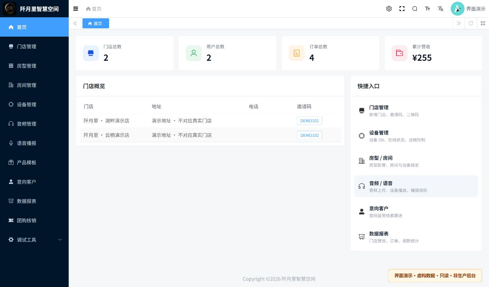
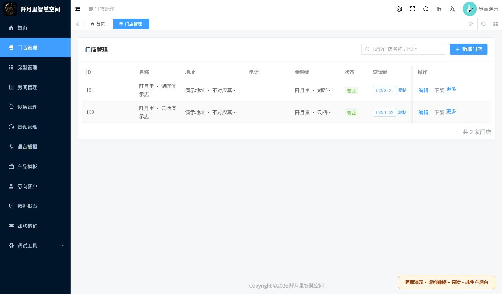
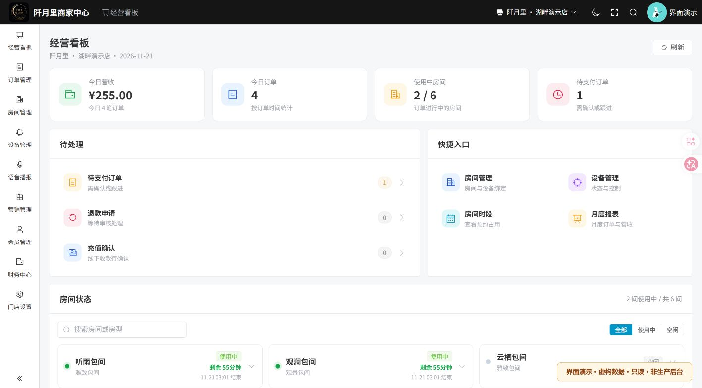
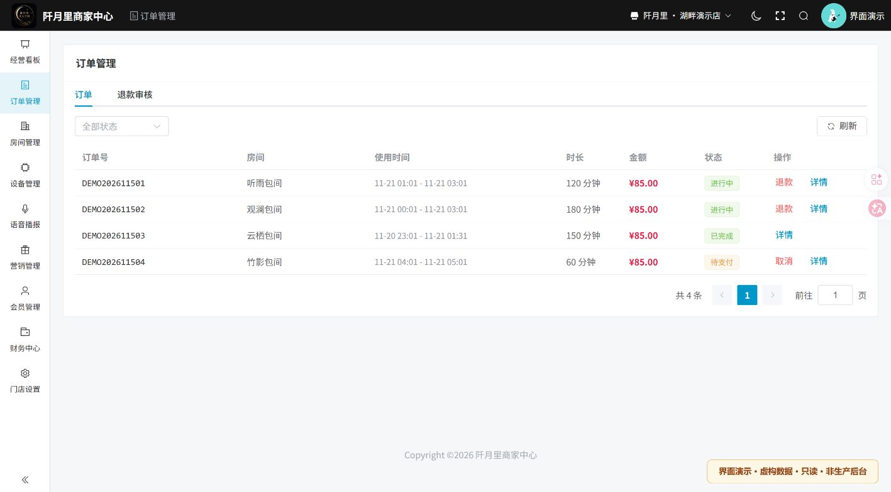
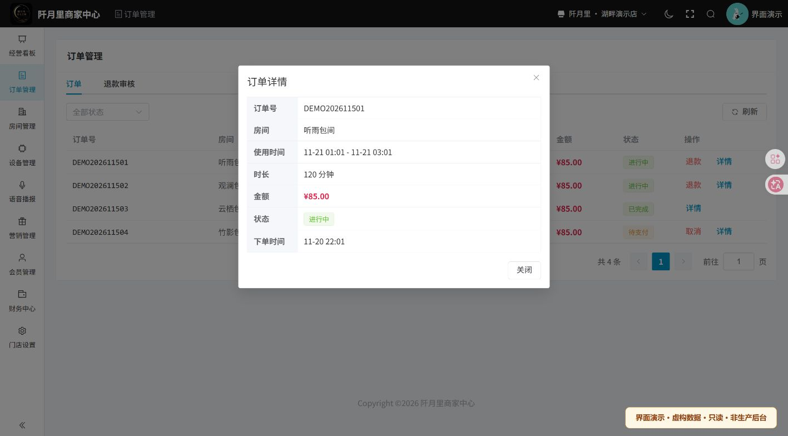
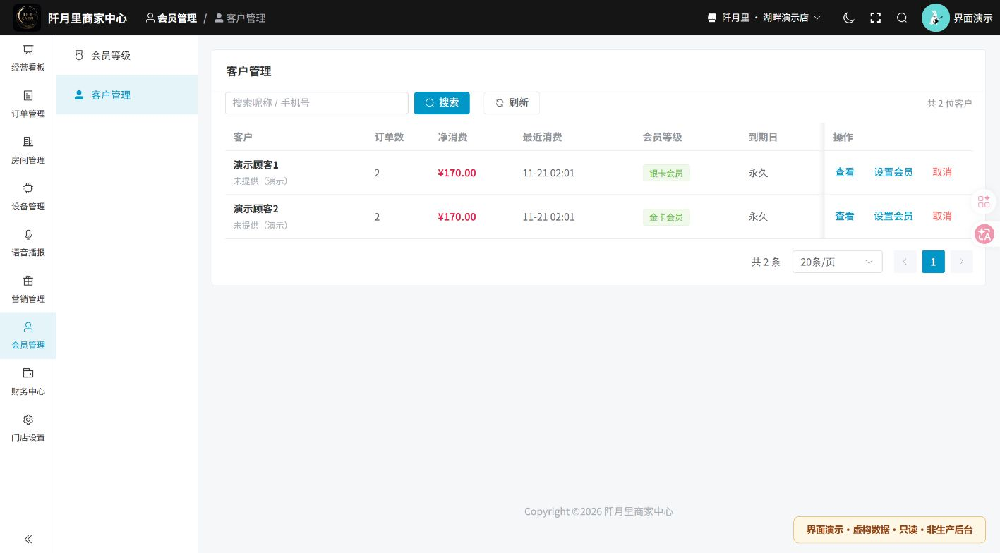

# 阡月里 · 智慧空间管理系统

面向无人棋牌室的多端空间管理系统，连接用户预约、商家运营、平台管理与智能设备。

通过用户端微信小程序完成门店浏览、房间预约和订单管理，通过商家后台管理房间、会员与经营数据，通过平台后台统一维护门店和设备，使用 MQTT 连接空间内的智能控制器。

## 界面预览

| 平台首页 | 门店管理 |
| --- | --- |
|  |  |

| 商家经营看板 | 订单管理 |
| --- | --- |
|  |  |

| 订单详情 | 客户与会员 |
| --- | --- |
|  |  |

本地界面演示：构建两个前端后执行 `python demo/serve.py`。平台演示账号为 `demo / demo`，商家演示邀请码为 `DEMO101`；运行方式见 [演示说明](demo/README.md)。

## 核心功能

| 模块 | 功能 |
| --- | --- |
| 用户小程序 | 门店与房间浏览、预约、订单、充值与兑换、会员信息、设备控制 |
| 商家管理 | 房间与资源、价格配置、订单、设备、语音配置、客户与会员、经营报表 |
| 平台管理 | 多门店、商家账号、设备与产品模板、订单审核、系统配置、统计与审计 |
| Go 后端 | 身份认证、门店权限、预约计价、余额与会员折扣、定时任务、WebSocket、MQTT |
| Windows 桌面入口 | 内嵌前端静态资源、托盘入口、本地 HTTP 服务与 API 反向代理 |

## 技术栈

| 层级 | 技术 |
| --- | --- |
| 后端 | Go、Gin、GORM、JWT、WebSocket |
| 数据与缓存 | MySQL、Redis |
| 管理后台 | Vue 3、TypeScript、Vite、Element Plus、Pinia |
| 移动端 | 微信小程序 |
| 设备通信 | MQTT、EMQX |
| 桌面与部署 | Go、Windows 系统托盘、Docker Compose |

## 项目结构

| 路径 | 内容 |
| --- | --- |
| `backend/` | Go + Gin + GORM；含测试及数据库迁移 |
| `admin-web-v3/` | Vue 3 平台后台 |
| `admin-merchant-v3/` | Vue 3 商家后台 |
| `admin-desktop/` | 平台 Windows 桌面入口 |
| `merchant-desktop/` | 商家 Windows 桌面入口与安装脚本 |
| `miniprogram-user-new/` | 用户微信小程序 |
| `miniprogram-merchant-new/` | 商家微信小程序 |
| `scripts/` | 本地配置初始化 |
| `docs/` | 系统架构、开发文档与截图 |
| `demo/` | 本地界面演示 |

## 快速开始

要求：Go 1.26、Node.js >=20.19、pnpm >=8.6、Docker Compose；小程序使用微信开发者工具。

```powershell
# 在仓库根目录执行：生成本地配置，不覆盖已有文件
powershell -ExecutionPolicy Bypass -File scripts/setup-local.ps1

# 仅启动本机依赖，不包含后端或前端
docker compose up -d

# 新终端：启动后端；MySQL 首次初始化可能需要等待
cd backend
go run ./cmd/server
```

```powershell
# 新终端：平台后台
cd admin-web-v3
pnpm install --frozen-lockfile
pnpm dev

# 另一个终端：商家后台
cd admin-merchant-v3
pnpm install --frozen-lockfile
pnpm dev
```

平台后台默认 `http://localhost:5173`，商家后台 `http://localhost:5174`，API `http://localhost:8080`。

账号初始化、小程序配置、外部服务接入及桌面打包见 [开发说明](docs/DEVELOPMENT.md)。

## 测试

本机已有依赖时，可在仓库根目录执行 `powershell -ExecutionPolicy Bypass -File scripts/check-local.ps1`，统一运行后端测试、两端类型检查、业务 UI lint 和两种前端构建。脚本直接调用本地工具，不会自动下载安装依赖。

```powershell
cd backend
go test ./...
```

前端各自提供 `pnpm ts:check`、`pnpm lint`、`pnpm build` 和 `pnpm build:desktop`。

GitHub Actions 配置覆盖后端测试、前端类型检查、业务页面 ESLint，以及网页端和桌面端前端构建。

## 文档

- [系统架构](docs/ARCHITECTURE.md)
- [开发说明](docs/DEVELOPMENT.md)
- [本地演示](demo/README.md)

## 配套硬件与商业合作

使用本项目搭建无人棋牌室或其他自助空间，欢迎向作者咨询和采购配套硬件，包括设备选型、控制器接入与适配需求。

硬件采购、项目合作及商业授权，请通过[项目 Issues](https://github.com/xx0-0xx/qianyueli-smart-space/issues)联系作者，说明门店规模、设备类型及使用场景。

## 使用许可

本项目自有代码允许非商业学习、研究和测试。**用于门店经营、客户项目交付、收费服务、软件销售或其他商业用途，须事先取得作者的书面许可。**

采购硬件不自动包含软件商业授权，具体以双方书面约定为准。完整条款见 [LICENSE](LICENSE)。

## 第三方来源

管理后台基于 yudao-ui-admin-vue3 / vue-element-plus-admin 定制，相关许可证保留在对应前端目录中。详见 [第三方来源](THIRD_PARTY_NOTICES.md)。
